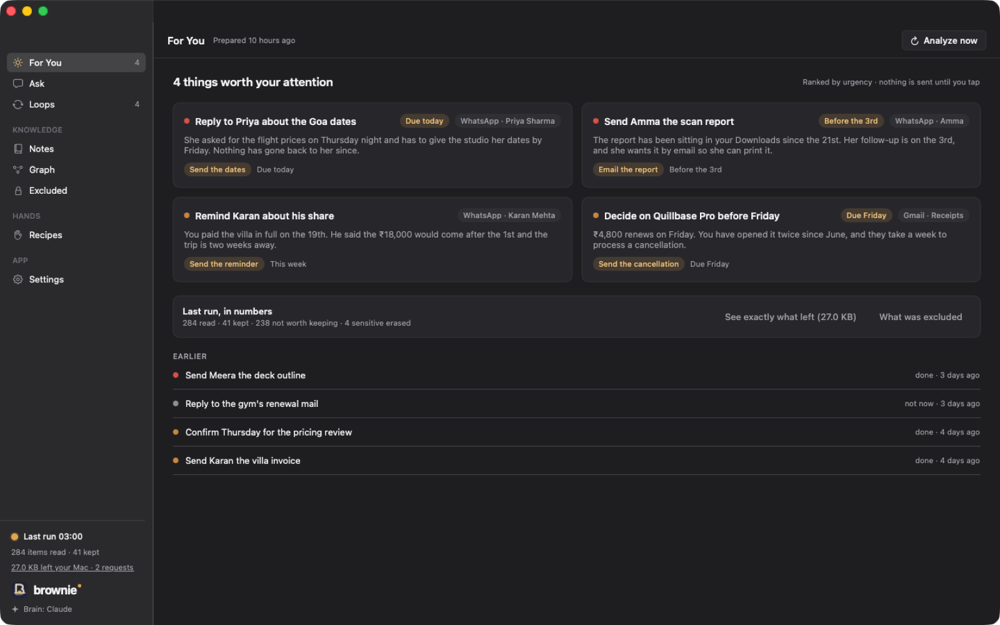
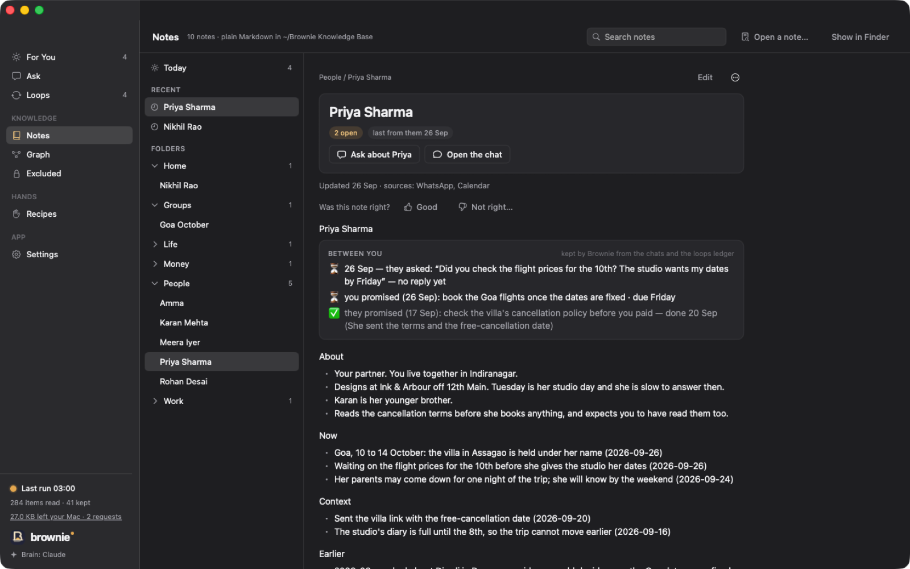
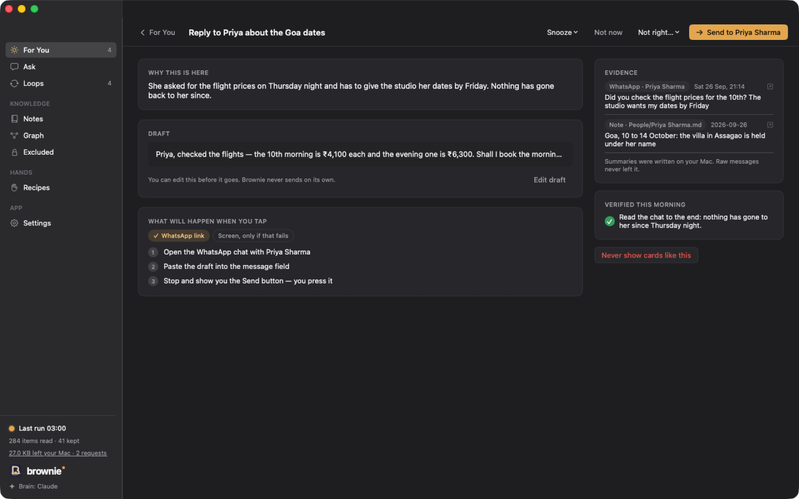
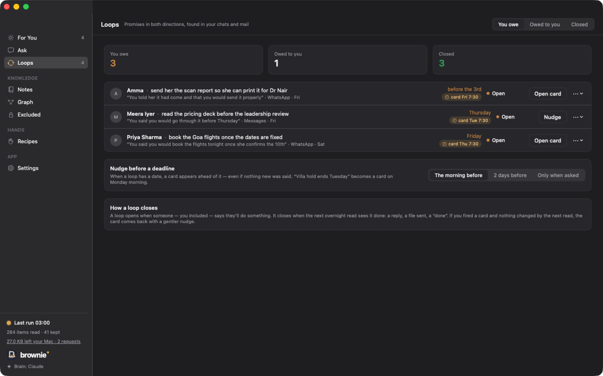

# Brownie

**A house spirit that lives in your Mac.** Every night, while the Mac is plugged in and you are asleep, Brownie wakes it, reads what is new in your life with a model that never leaves the machine, writes private notes, and leaves a handful of morning cards. **Hands** does the steps for you in your own apps, and stops one step short of Send.

[**Download for macOS**](https://github.com/Brownie-app/brownie/releases/latest) · [usebrownie.com](https://usebrownie.com) · Free, AGPL-3.0, no account, no server



*Apple silicon · macOS 14 or later · your own OpenAI or Claude key, or no key at all*

---

## What it actually does

**It reads at night, on this Mac.** Files (skipping code projects and bulk folders), Apple Notes, iMessage, WhatsApp Desktop, Telegram, Calendar (EventKit), Mail over IMAP (Gmail, iCloud, Outlook, Fastmail or any server), Slack, Teams, meeting recordings transcribed by Apple's own speech engine, and work apps over MCP — Linear, GitHub, Notion, Granola presets, or any server you point it at. A small model on your GPU decides what is worth keeping. Almost everything is thrown away.

**It keeps one note per person, forever.** What they asked you, what you promised them, what is still open between you. Written by code, not by the model, so it cannot drift.



**It leaves four things in the morning, not a feed.** Each card says why it matters, shows the message it came from, and drafts a reply in your own words.



**It stops before Send.** Hands opens the chat, types the message, and hands you the button. That is the whole design, and it is enforced in code, not in a prompt.

**It tracks promises in both directions** — yours and theirs — and brings a card back if the next night sees no reply.



## Beyond the morning cards

**Ask** — questions answered from your own notes, with citations that open the original message.

**The vault** — your notes are an Obsidian vault: `[[wikilinks]]`, Open in Obsidian, an iCloud Drive mirror for your phone. Yours to edit, and still yours if you delete Brownie.

**Brownie as an MCP server** — run `Brownie mcp` and Claude Desktop, Cursor or any MCP app can read your notes. This Mac only, with a log of what they asked.

**Recipes** — teach Hands something by doing it once. It replays by app link, accessibility tree, or the screen where you allow it, and stops before Send. Runnable from ⌘⇧Space, Shortcuts and Siri (`brownie://run?recipe=…`).

- **Pre-meeting briefs** — ten minutes before a meeting, from your People notes.
- **A Sunday letter** — what the week actually held.
- **What left your Mac** — every request to the brain, byte for byte.
- **This Mac only** — the reader doubles as the brain. Nothing is sent anywhere.
- **Panic wipe** — hold to erase everything.
- **Daytime reads** — every hour or three, while idle and on power.

The behaviour is specified in `docs/spec/12-loops-briefs-recipes-trust.md`.

## What leaves your Mac

| | |
|---|---|
| Your messages, mail, files, notes | **Never leave.** The reader runs on your GPU. |
| Short summaries | Go to the brain *you* chose — or nowhere, in This Mac only mode. |
| Every byte that goes out | Listed in **What left your Mac**, byte for byte, in the app. |
| Accounts, telemetry, crash reports | None. There is nothing to sign up for and no Brownie server. |

An item the reader marks sensitive is dropped whole: no title, no summary, no card, and no line about it in Brownie's own logs — only a count, the time and which source it came from. Behind the model a deterministic backstop catches six high-risk identifier classes (US Social Security number, Luhn-valid card number, Aadhaar, PAN, passport, bank account with IFSC). There are tests for both.

## Not in this build yet

The sealed cloud mirror (v1.1) and self-updating builds — 0.1 has to be replaced by hand when a new version ships (`Scripts/sparkle-keys.sh` is ready; the feed is not).

## Run it

Requirements: Apple silicon, macOS 14+, Xcode 16.

```bash
brew install cmake gperf openssl@3
./Scripts/build-tdlib.sh                    # once: builds the Telegram library into Vendor/tdlib (~30 min)
./Scripts/bundle.sh && open dist/Brownie.app
```

The first launch walks you through: downloading the reader (Gemma 4 E4B, 3.7 GB, public), choosing a brain (your own OpenAI / Anthropic / OpenRouter key, or a local server), picking sources, permissions, the overnight time, and the first read.

For development, put your keys in `.secrets/brownie.env` (git-ignored; Debug builds read it). Telegram needs your own api_id/api_hash there — Brownie ships none. Mail needs nothing: it is IMAP, and the user's own app password lives in their Keychain. See `docs/launch-setup.md`.

```bash
swift build && swift test          # 832 tests: cursors, atomic commit, fail-closed parsing, PII backstop, windowing
swift run browniectl list files ~/Documents
swift run browniectl read files ~/Downloads   # judge a folder with the reader from Terminal
```

## Where things are

| Path | What |
|---|---|
| `docs/spec/` | The behavioural spec — start with `00-overview.md` |
| `design/` | The design canvas source (`*.dc.html`); `design/v2/` is the second prototype |
| `Sources/Domain` | Value types and protocols; depends on nothing |
| `Sources/Ingest` | The reading pipeline + the reader's prompts (`Prompts/*.md`) |
| `Sources/Inference` | LiteRT-LM reader, model download |
| `Sources/LocalSources` | Files, Apple Notes, iMessage, WhatsApp |
| `Sources/Privacy` | PII backstop and the sensitivity policy |
| `Sources/Brain` | OpenAI-compatible and Claude engines, our own tool loops |
| `Sources/Knowledge` | The Markdown knowledge base, index, agentic builder |
| `Sources/Proactive` | Judge → verify & prepare → fire |
| `Sources/Pipeline` | One run, end to end |
| `Sources/Scheduling` | 3 AM wake, root helper with deadman, power rules |
| `Sources/Agent` | Hands: accessibility-tree computer use with the never-press-Send policy |
| `Sources/BrownieApp` | SwiftUI app: every screen from the design, walkthroughs, menu bar |
| `Sources/CloudSources` | Mail over IMAP, Slack, Teams, generic MCP client + presets |
| `Sources/TelegramSource` | Telegram over TDLib |
| `Vendor/LiteRTLM` | Google's LiteRT-LM Swift package (Apache-2.0), manifest patched for Swift 6.0 |
| `Vendor/tdlib` | TDLib headers; the dylibs are built locally by `Scripts/build-tdlib.sh` |

## Invariants (tests exist for each)

1. Raw files, messages and mail bodies never leave the Mac. What a cloud brain receives is listed in [the privacy spec](docs/spec/09-privacy.md): reader summaries, your Markdown notes when it judges or grounds Hands, and — only while Hands is running — the frontmost app's accessibility tree, plus a screenshot if you granted Screen Recording.
2. An item marked sensitive leaves no title, no summary, no card and no log line — a count and a source, nothing else.
3. The reader's judgement fails closed: unparseable ⇒ dropped.
4. Nothing is sent, paid, submitted or deleted without your tap on that step.
5. Every card carries its evidence.
6. Run numbers are honest: read · kept · not worth keeping · sensitive erased.
7. No account; the Mac's copy is the truth; deletion is total.
8. Walkthroughs play once.

## Eval

`swift test --filter EvalTests` scores the reader's prompts against `Tests/Eval/Corpus/corpus.json` (keep / drop / sensitive, no private-specific leaks, group-chat attribution). Add a case whenever the reader gets something wrong on your real data.

## Contributing and licence

Brownie is open source under the [GNU AGPL-3.0](LICENSE). Contributions are welcome — read [CONTRIBUTING.md](CONTRIBUTING.md) first; contributors sign a short [CLA](CLA.md) so the project can also be offered under a commercial licence. Security issues: [SECURITY.md](SECURITY.md).

Releases are built on the maintainer's Mac, signed with a Developer ID certificate and notarised by Apple — CI only builds and tests, so no signing key or credential ever lives on a server. The steps are in [RELEASING.md](RELEASING.md).

Third-party: LiteRT-LM (Apache-2.0), TDLib (BSL-1.0), OpenSSL (Apache-2.0), Sparkle (MIT), Gemma 4 weights under Google's Gemma terms (downloaded by the user, never redistributed here).

---

Inspired by all personal assistant apps and the architecture of Sentient OS · Made with ❤️ in India
